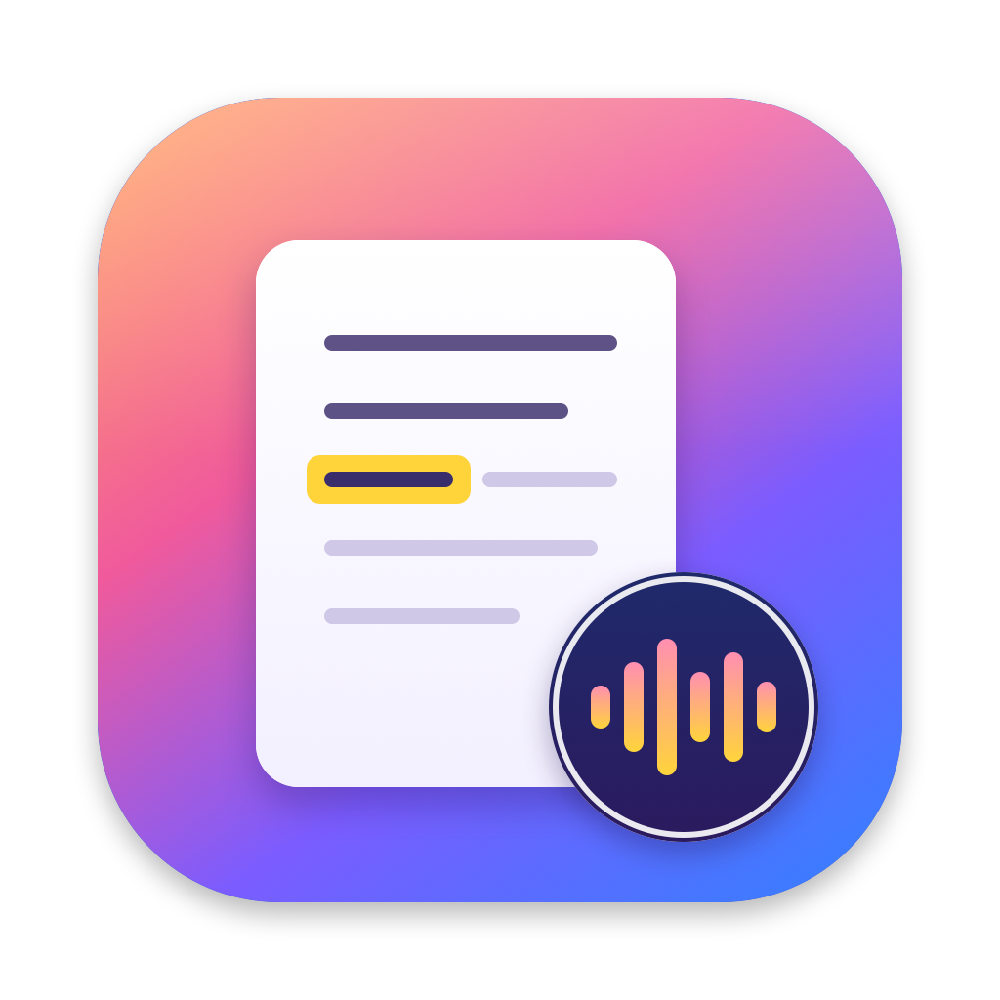
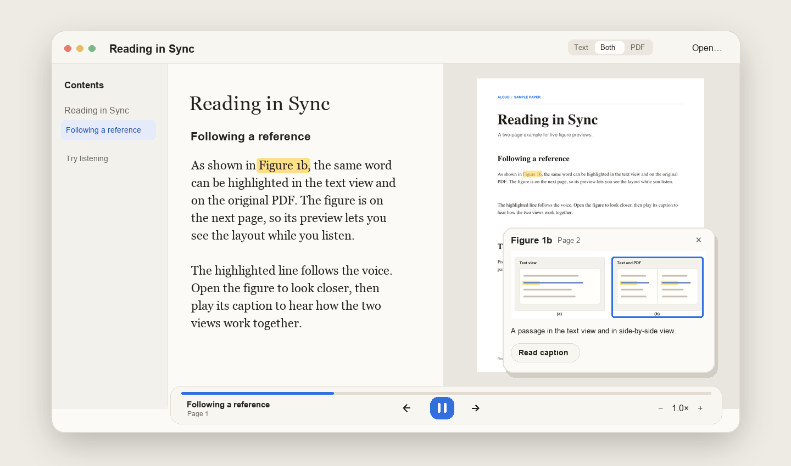

<p align="center"></p>
<h1 align="center">ALOUD</h1>
<p align="center">Listen to research papers and follow every word on the original PDF.</p>



ALOUD is a macOS reader with on-device speech. It highlights the words it reads, opens the figure a paper is discussing, and returns to your place after reading its caption.

## Install

You'll need an **Apple-silicon Mac** with **macOS 14 or later** and **uv**. [Install uv](https://docs.astral.sh/uv/getting-started/installation/)

Clone the repository and run the installer.

```sh
git clone https://github.com/Neilus03/ALOUD.git
cd ALOUD
sh scripts/install.sh
```

Open **ALOUD** from **Home → Applications** in Finder. The installer sets up Python 3.12 and the pinned dependencies in your home folder. ALOUD downloads model files on first use. You can listen to local PDFs offline once those files are cached.

### Try the figure preview

1. Open [Reading in Sync](examples/reading-in-sync.pdf) and select **Both**.
2. Press **Space**. When the voice reads **Figure 1b**, the figure appears and panel **b** is outlined.
3. Click the figure to enlarge it. Choose **Read caption** to hear the caption and return to the same word.

## Reading and listening

- **Read on the page.** Switch between the original PDF and a clean text view, or keep both open. Scanned PDFs use macOS text recognition.
- **Choose a voice.** Heart is the default. Choose **Alba · Pocket TTS** in settings for an English voice suited to papers. Both highlight words as they read.
- **Follow references.** Figures open beside the text when their captions can be matched. Press **C** at a citation to see the referenced work.
- **Keep your place.** Mark a sentence with **M**, write a note with **N**, or queue the next paper. Notes are saved as Markdown with links back to the document.
- **Read other formats.** Open EPUBs and Word documents, paste text, or send a web article from your browser. Use the in-app guide (**?**) for setup and shortcuts.

## How it works

PyMuPDF extracts the PDF's reading order and word positions. Kokoro synthesizes short passages and supplies word timings. Alba uses Pocket TTS with CavaAlign for word timings. ALOUD maps those timings back to the text and page, then uses the spoken reference to select a figure crop. A native macOS window hosts the interface through pywebview.

Speech, PDF processing, and reading history stay on your Mac. ALOUD uses the network to download voice weights and fetch web articles and images you request. **Send to ALOUD** is paired to your installation. Set up its bookmarklet from ALOUD's settings.

## Develop

```sh
uv venv --python 3.12
uv pip sync requirements-macos-arm64.txt
uv pip install --no-build-isolation --no-deps --editable .
.venv/bin/aloud examples/reading-in-sync.pdf
.venv/bin/python scripts/smoke-test.py
```

Set `ALOUD_DATA_DIR` to a separate folder to test with a fresh library. The [setup notes](docs/setup.md) cover optional speech and OCR models, the Quick Action, and where files are stored.

## License

ALOUD is released under the [GNU Affero General Public License, version 3](LICENSE). The [third-party notices](THIRD_PARTY.md) credit the original project and the libraries and assets used here.
